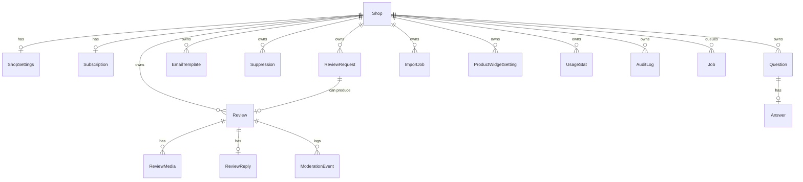

# Data model (Phase 3)

PostgreSQL through Prisma (`prisma/schema.prisma`). Extra database rules live in `prisma/constraints.mjs` and are applied
with `npm run db:constraints` (CHECK constraints and partial indexes that Prisma cannot express).

## Relationships

## Entities
| Model | Purpose | Owned by shop | Retention |
|---|---|---|---|
| `Session` | Shopify login sessions (library-managed) | by shop domain | Deleted on uninstall and shop/redact |
| `Shop` | One row per installed store | root | Deleted on shop/redact (cascades to everything below) |
| `ShopSettings` | Merchant settings | yes | With shop |
| `Subscription` | Local copy of the Shopify subscription | yes | With shop |
| `Review` | A review; product is referenced by Shopify product ID (no product table is kept) | yes | Soft-deleted, purged after 30 days |
| `ReviewMedia` | Photo metadata (files live in object storage) | yes | With review; files removed by purge |
| `ReviewReply` | Merchant reply, one per review | yes | With review |
| `ModerationEvent` | History of status changes and edits | yes | With review |
| `ReviewRequest` | Scheduled and sent review request emails and reminders | yes | Email and name removed 90 days after finishing |
| `EmailTemplate` | Custom email text (Advanced) | yes | With shop |
| `Suppression` | Unsubscribed addresses stored as one-way hashes | yes | With shop |
| `Question`, `Answer` | Product Q&A | yes | With shop |
| `ImportJob` | CSV import preview and progress; parsed rows are cleared after import | yes | Unconfirmed previews purged after 1 day |
| `ProductWidgetSetting` | Per-product widget overrides (Advanced) | yes | With shop |
| `UsageStat` | Daily counters | yes | With shop |
| `AuditLog` | Important merchant actions and privacy data requests | yes | With shop |
| `Job` | Background job queue (imports, purge) | optional | Finished jobs purged after 14 days |
| `WebhookEvent` | Webhook IDs seen, for de-duplication | no (no personal data) | Purged after 30 days |
| `PrivacyEvent` | Record that an erasure or data request was handled; holds no personal data | no | Kept |

## How tenant isolation is enforced
1. Every merchant-owned table has a `shopId` column and a foreign key to `Shop` with `ON DELETE CASCADE`. `npm run check:schema` and a unit test verify this for every model.
2. Every service function takes `shopId` and puts it in the `where` or `data` of every query. `npm run check:tenant` parses all code with the TypeScript compiler and fails if any Prisma call on merchant data lacks `shopId`, or if raw SQL appears. Exceptions are listed with reasons in `scripts/check-tenant-scope.mjs`.
3. Linking records across tables is validated in code (for example a review may only link to a request of the same shop).
4. `test-db/tenant-isolation.test.ts` creates two synthetic shops with deliberately overlapping product IDs, order IDs and emails and proves one cannot read, change or delete the other's data. **Needs a real PostgreSQL test database.**

Not done: composite foreign keys `(shopId, id)` that would make the database itself reject cross-shop links, and row-level security.
These would add a second layer; they were left out because they cannot be validated without running Prisma, and the code-level checks above cover the same cases.

## Database rules (`prisma/constraints.mjs`)
25 CHECK constraints (rating 1 to 5, text lengths, allowed values, numeric ranges, non-negative counters) and 3 partial indexes
(due review requests, public review listing, purge candidates). Their SQL is executed against SQLite in the unit tests to prove the
expressions are valid and reject bad data; the PostgreSQL version is applied and enforced in `test:db`.

## Migrations
- First time: `npm run db:init` creates `prisma/migrations/<timestamp>_init`. Commit it.
- Then: `npm run db:constraints` (safe to repeat).
- Later changes: edit `schema.prisma`, run `npm run db:migrate -- --name what_changed`, commit the new folder.
- Production release step: `npx prisma migrate deploy` then `npm run db:constraints`. Never run `migrate dev` or `migrate reset` against production.
- Destructive changes (dropping a column) should be done in two releases: stop using it, then remove it.

## Performance notes
Lists are paginated with bounded page sizes. Indexes: `(shopId, shopifyProductId, status, createdAt)`, `(shopId, status, createdAt)`, due-request and public-listing partial indexes, unique keys on import keys and webhook IDs.
No query performance has been measured on real data.
